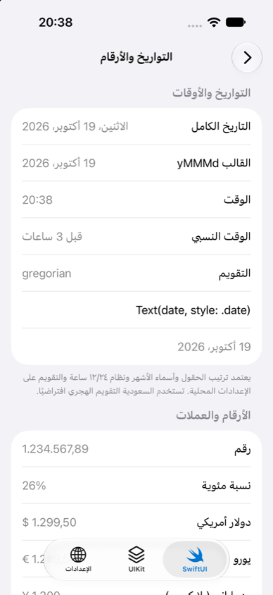

# iOS 国际化适配指南

> 一份可以直接落地的 iOS 多语言适配手册：怎么做、会踩哪些坑、怎么解决。
>
> 文中所有结论都在本项目 Demo 中有对应页面，并在 **Xcode 27 / iOS 27 模拟器**上实测过。标「实测」的条目是与常见说法不一致、或文档里没写清楚的行为。

**配套代码**

| 内容 | 位置 |
| --- | --- |
| 生产可用框架 | [`Packages/WBLocalizationKit`](../Packages/WBLocalizationKit) |
| 示例 App（SwiftUI + UIKit 对照） | [`WBLocalization/Features`](../WBLocalization/Features) |
| 翻译质量测试 | [`WBLocalizationTests`](../WBLocalizationTests) |
| 多语言截图脚本 | [`Scripts/screenshots.sh`](../Scripts/screenshots.sh) |

---

## 目录

1. [适配全景清单](#1-适配全景清单)
2. [工程配置](#2-工程配置)
3. [文案规范](#3-文案规范)
4. [语言切换](#4-语言切换)
5. [日期、数字与货币格式化](#5-日期数字与货币格式化)
6. [RTL（从右到左）布局](#6-rtl从右到左布局)
7. [长文本与字体排版](#7-长文本与字体排版)
8. [双向文本](#8-双向文本)
9. [资源与系统级文案](#9-资源与系统级文案)
10. [服务端协作](#10-服务端协作)
11. [测试与 CI](#11-测试与-ci)
12. [常见坑速查表](#12-常见坑速查表)

---

## 1. 适配全景清单

上线一个新语言前，逐项确认：

| 类别 | 检查项 | Demo 页面 |
| --- | --- | --- |
| 工程 | 已添加语言；String Catalog 中没有 `New` / `Needs Review` 状态 | — |
| 文案 | 没有字符串拼接；多参数文案使用位置参数；数量相关文案全部配置了复数 | 基础文本、复数 |
| 文案 | 文案中没有被误识别为格式占位符的字面量 `%` | — |
| 切换 | 选择语言后文案、布局方向、格式化、图片同时生效；重启后保持一致 | 设置 |
| 格式化 | 日期、数字、货币、单位、列表全部通过 formatter 输出，并使用 App 当前 locale | 日期与数字 |
| RTL | 约束只用 leading/trailing；方向性图标镜像，非方向性图标不镜像；动画与横向列表方向正确 | RTL 布局、图片 |
| 长文本 | 无固定宽度单行文本；按钮能自适应；导航标题不截断 | 长文本 |
| 字体 | CJK 文本标注语言；阿语没有被固定行高裁切；自定义字体覆盖目标字符集 | 字体与排版 |
| 双向文本 | 用户昵称、手机号、话题标签、版本号等插值内容已隔离 | 双向文本、输入 |
| 资源 | 含文字的图片按语言提供；启动屏不含文字 | 图片、系统文案 |
| 系统文案 | App 名称、权限说明已翻译；了解它们只在重启后切换 | 系统文案 |
| 服务端 | 请求带 `Accept-Language`；缓存 key 含语言；时间按 ISO 8601 传输 | 服务端内容 |
| 测试 | 翻译完整性测试通过；伪语言与 RTL 冒烟测试；各语言截图人工走查 | — |

---

## 2. 工程配置

### 2.1 添加语言与开发语言

1. **Project → Info → Localizations** 中添加语言。
2. **开发语言**（Development Language）决定 String Catalog 的源语言和兜底行为。本项目以中文开发，开发语言为 `zh-Hans`。
3. 对于以中文开发、面向海外的 App，开发语言可以保持中文，但**兜底语言**应设为英文（见 [4.6](#46-语言匹配与回退)）。

### 2.2 String Catalog（.xcstrings）

String Catalog 是 Xcode 15 引入的字符串资源格式，用一个 JSON 文件管理所有语言，Xcode 有可视化编辑器。

- **最低系统不受限**：`.xcstrings` 在**编译期**被转换成 `.strings` / `.stringsdict`，所以 iOS 15 也能用（本项目即为 iOS 15）。
- **迁移**：在旧的 `.strings` / `.stringsdict` 文件上右键 → *Migrate to String Catalog*。
- **建议的 Build Settings**：

| 设置 | 值 | 作用 |
| --- | --- | --- |
| `LOCALIZATION_PREFERS_STRING_CATALOGS` | YES | 新建本地化资源时使用 String Catalog |
| `SWIFT_EMIT_LOC_STRINGS` | YES | 编译时自动提取 `String(localized:)` 等调用中的 key |

- **动态 key**：由数据拼接的 key（如 `"feature.\(rawValue).title"`）无法被自动提取，需要在 Catalog 中手动添加，并标记为 *Manually* 管理，防止被 Xcode 标成 *Stale*。
- 每条文案都要写 **Comment**，告诉译者文案出现在哪里、参数是什么。

本项目的三个 Catalog：

| 文件 | 内容 |
| --- | --- |
| `Localizable.xcstrings` | 界面文案（167 个 key × 6 种语言） |
| `InfoPlist.xcstrings` | App 名称、权限说明 |
| `LaunchScreen.storyboard` | 不做本地化（原因见 [9.2](#92-启动屏)） |

### 2.3 Info.plist 本地化

- `InfoPlist.xcstrings` 中的每个 key，Info.plist 里必须有对应的**基础值**（本项目通过 Build Settings 的 `INFOPLIST_KEY_*` 设置），否则翻译不会生效。
- **实测**：使用 `InfoPlist.xcstrings` 后，Xcode 会往 Info.plist 写入 `CFBundleLocalizations`，此时 `Bundle.main.localizations` 会把它和 `.lproj` 目录合并，**返回重复项**。如果你用它生成语言列表，界面上每种语言会出现两次。框架里的 `AppLanguage.available()` 已做去重。

### 2.4 Swift Package 中的本地化

框架或模块自己的文案放在 Package 里时：

```swift
let package = Package(
    name: "MyFeature",
    defaultLocalization: "en",          // 有本地化资源时必填
    targets: [.target(name: "MyFeature", resources: [.process("Resources")])]
)
```

取值时要传 `bundle: .module`。注意：App 内切换语言对 `.module` 不生效（框架只替换 `Bundle.main`），这类模块需要自行根据 `LocalizationContext.code` 选择 `.lproj`。

---

## 3. 文案规范

### 3.1 Key 命名

采用 `模块.页面/组件.语义` 的结构化 key，而不是直接用中文原文做 key：

```text
basic.welcome            plurals.files          settings.system.footer
```

- 同一段中文在不同场景可能需要不同译法（如「打开」可以是 Open，也可以是 On），结构化 key 才能区分。
- 改中文措辞时不会影响 key，也就不会让所有语言的翻译失效。

### 3.2 禁止字符串拼接

```swift
// ❌ 语序固定、无法处理复数：英语得到 “You have 1 new messages”
"\(prefix) \(count) \(suffix)"

// ✅ 完整句子 + 复数规则
L10n.format("basic.messages", count)
```

### 3.3 位置参数

不同语言的参数顺序不同，多参数文案必须使用 `%1$@`、`%2$@`：

| 语言 | `basic.welcome`（%1$@ = 用户名，%2$@ = 城市） |
| --- | --- |
| 中文 | `%1$@，欢迎来到%2$@！` |
| 英语 | `Welcome to %2$@, %1$@!` |
| 日语 | `%2$@へようこそ、%1$@さん！` |

### 3.4 复数


| 语言 | CLDR 复数类别 | 示例 |
| --- | --- | --- |
| 中文、日语 | other | 3 个文件 |
| 英语、德语 | one, other | 1 file / 2 files |
| 俄语 | one, few, many, other | 1 файл / 3 файла / 5 файлов / 21 файл |
| 阿拉伯语 | zero, one, two, few, many, other | ملف واحد / ملفان / 3 ملفات / 11 ملفًا |

- 在 String Catalog 中右键 → *Vary by Plural*。
- Apple 在**任何语言**中都支持 `zero`，中文也可以把 0 单独写成「没有文件」。
- **多个数量**的句子（「N 个文件夹中共有 M 个文件」）用 *Vary by Plural* 分别为每个变量配置，Xcode 会生成 `%#@files@ in %#@folders@` 形式的替换模板。

> ⚠️ **坑（实测）**：`String(localized: "files \(count)")` 这种插值写法，参数格式化和复数规则使用的是 `Locale.current`，而 `Locale.current` **不随 App 内语言切换变化**，结果会出现俄语文案配英语复数规则。本项目统一用下面的写法：
>
> ```swift
> static func format(_ key: String, _ arguments: CVarArg...) -> String {
>     let format = Bundle.localized.localizedString(forKey: key, value: nil, table: nil)
>     return String(format: format, locale: LocalizationContext.locale, arguments: arguments)
> }
> ```
>
> 同理，`String(format:)` 不传 `locale` 时复数会一律取 `other`。

### 3.5 字面量百分号

> ⚠️ **坑（实测）**：英文文案 `30%+ longer` 中的 `%+ lo` 恰好是一个合法占位符（带 `+` 和空格标志的八进制 `%o`）。只要这条文案被当作格式串使用，就会读取不存在的参数，甚至崩溃。
>
> - 需要格式化的文案里，字面量百分号写成 `%%`；
> - 纯展示文案尽量写成「percent」或调整措辞；
> - 用测试兜底：本项目的 `formatSpecifiersMatchSourceLanguage` 会对比各语言与源语言的占位符，正是它发现了这个问题。

### 3.6 给翻译留余量

- 设计稿按英文 **+30%～50%** 宽度预留空间；短文本（按钮、标签）扩展比例更高，可能翻倍。
- 不要在代码里拼接标点、冒号、空格：法语冒号前有空格，中文用全角标点，阿语逗号是「،」。

---

## 4. 语言切换

### 4.1 两种方案

| | 系统 per-app 语言 | App 内切换（本项目框架） |
| --- | --- | --- |
| 入口 | 设置 → App → 本 App → 语言 | App 内设置页 |
| 生效方式 | 系统终止并重启 App | 即时生效，无需重启 |
| 文案、布局、格式化 | ✅ | ✅（框架统一处理） |
| App 名称、权限弹窗、系统控件文案 | ✅ | 下次冷启动生效 |
| 启动屏 | 不应用本地化（见 [9.2](#92-启动屏)） | 同左 |
| 开发成本 | 几乎为零 | 需要一套框架（本项目已提供） |

**建议两者都支持**：App 内提供语言列表，同时放一个「前往系统设置修改」入口（`LocalizationManager.shared.openSystemLanguageSettings()`）。

系统 per-app 语言的注意事项：

- App 至少要支持两种本地化，设置里才会出现「语言」选项；用户只设置了一种系统首选语言时，该选项也可能不显示。
- 系统修改的是 App 域 `UserDefaults` 中的 `AppleLanguages`，这一点很重要，见 [4.5](#45-持久化与系统设置的优先级)。

### 4.2 App 内切换的原理

核心是 `LocalizedBundle`：用 `object_setClass` 把 `Bundle.main` 的类替换为子类，重写两个方法：

```swift
override func localizedString(forKey key: String, value: String?, table: String?) -> String
override var preferredLocalizations: [String]
```

各种取值 API 是否跟随 App 内切换（实测）：

| API | 是否跟随 | 说明 |
| --- | --- | --- |
| `NSLocalizedString` / `Bundle.localizedString` | ✅ | 走重写的方法 |
| `"key".localized()`（框架） | ✅ | 同上，并按当前 locale 格式化参数 |
| storyboard / xib 文案 | ✅ | 同上 |
| Asset Catalog 本地化图片 | ✅ | 依赖重写的 `preferredLocalizations` |
| SwiftUI `Text("key")` | ✅ | 依赖环境 `\.locale`，由 `.localizedRoot()` 注入 |
| `String(localized: "key")` | ❌ | **iOS 上走 Foundation 内部路径，绕过重写**，重启后才变 |
| `String(localized: "key", bundle: .localized)` | ✅ | `Bundle.localized` 是当前语言的 `.lproj` |
| `Locale.current` / `Locale.preferredLanguages` | ❌ | 进程内缓存，用 `LocalizationContext.locale` |
| App 名称、权限弹窗、系统控件文案 | ❌ | 由系统按启动语言决定 |

> ⚠️ **坑（实测）**：在 macOS 上 `String(localized:bundle:)` 会经过重写的方法，在 iOS 上不会。只在 macOS 跑单元测试的话发现不了这个问题，框架测试务必同时在 iOS 模拟器上跑。

### 4.3 界面刷新

已经创建的视图不会自动更新文案和方向，切换后需要重建：

**UIKit**：监听通知，统一重建根控制器。

```swift
NotificationCenter.default.addObserver(forName: .wbLanguageDidChange, object: nil, queue: .main) { _ in
    MainActor.assumeIsolated {
        UIApplication.shared.relocalize { window in
            guard let old = window.rootViewController as? RootTabBarController else { return nil }
            return RootTabBarController(selectedIndex: old.selectedIndex) // 保持当前 Tab
        }
    }
}
```

框架在切换时会设置 `UIView`、`UINavigationBar`、`UITabBar`、`UISearchBar`、`UIToolbar` 的 `semanticContentAttribute` appearance。导航栏要单独设置，因为它决定返回按钮的位置和侧滑返回的方向。

**SwiftUI**：在根视图（每个 `UIHostingController` 的 rootView）使用：

```swift
NavigationView { CatalogView() }
    .localizedRoot()   // 注入 \.locale、\.layoutDirection，语言变化时以 .id 重建视图树
```

重建会丢失 `@State`（包括导航栈）。需要保留页面状态时传 `rebuildsOnChange: false`，并确保所有文案都在 `body` 里实时计算。

**文案入口一律用计算属性**：

```swift
enum L10n {
    enum Tab {
        // ✅ 每次取值都走当前语言
        static var settings: String { String(localized: "tab.settings", bundle: .localized) }
        // ❌ static let 只在首次访问时求值，切换后仍是旧文案
    }
}
```

### 4.4 接入步骤

```swift
// 1. 在 AppDelegate.didFinishLaunching 最早处调用（创建任何界面之前）
LocalizationManager.shared.bootstrap(fallbackLanguage: "en")

// 2. 语言列表：首项为「跟随系统」，其余从 Bundle 自动读取
let languages = LocalizationManager.shared.availableLanguages
language.nativeName                                        // العربية（用该语言自身书写）
language.displayName(in: LocalizationManager.shared.locale) // 阿拉伯语（当前语言下的译名）

// 3. 切换
LocalizationManager.shared.setLanguage(.specific("ar"))
LocalizationManager.shared.setLanguage(.system)

// 4. 取值
String(localized: "home.title", bundle: .localized)
"plurals.files".localized(count)
```

> 语言列表的主标题用**该语言自身的名称**：用户误切到看不懂的语言时，仍然能找到自己的母语。

### 4.5 持久化与系统设置的优先级

框架保存 App 内选择的同时，会把 `[code]` 写入 App 域的 `AppleLanguages`，这样**下次冷启动**时 App 名称、权限弹窗、系统控件也是同一种语言。

由此带来一个冲突：用户在系统设置里修改本 App 语言时，改的也是这个 `AppleLanguages`。框架的处理方式：

1. 写入时额外记录「上次写入的值」；
2. 启动时如果 `AppleLanguages` ≠ 上次写入的值，说明用户在系统设置里改过，**以系统为准**，清除 App 内选择（只清除自己的 key，保留系统写入的 `AppleLanguages`）；
3. 通过启动参数 `-AppleLanguages (ar)` 指定语言时，只对本次运行生效，不改动持久化的选择。

此外，从「指定语言」切回「跟随系统」时，`Locale.preferredLanguages` 在进程内是缓存的，仍可能返回旧值。框架改为读取移除 App 域值之后的 `UserDefaults` 中的 `AppleLanguages`，它会立即回落到全局（系统）设置。

### 4.6 语言匹配与回退

> ⚠️ **坑（实测）**：`Bundle.preferredLocalizations(from:forPreferences:)`
>
> - 没有任何匹配时返回 `en`（如果支持英文），而不是开发语言，调用方也**无法区分**「真匹配」和「兜底」；
> - **不会**跨文字变体回退：`zh-Hant`、`zh-HK`、`zh-TW` 用户在只支持 `zh-Hans` 的 App 中会得到英文。

框架的 `LanguageResolver`：

- 逐个检查用户的偏好语言，第一偏好不支持时继续用第二偏好（`["fr-FR", "de-DE"]` → `de`）；
- 地区变体交给系统匹配（`en-GB` → `en`，`de-AT` → `de`）；
- 同一语言的不同文字之间回退（`zh-Hant-HK` → `zh-Hans`），可通过 `allowsScriptFallback` 关闭；
- 都不匹配时使用可配置的兜底语言（`bootstrap(fallbackLanguage:)`）。

`LocalizationManager.locale` 由「App 语言 + 用户地区」组成（如 `ar_CN`、`de_CH`），与系统 per-app 语言的行为一致。地区会影响货币、度量单位、数字字形和历法，见下一节。

---

## 5. 日期、数字与货币格式化



### 5.1 原则

- 所有展示都通过 formatter 输出，并使用 **App 当前 locale**（`LocalizationContext.locale`），而不是 `Locale.current`。
- SwiftUI 的 `Text(date, style:)`、`.formatted()` 读取环境 `\.locale`，由 `.localizedRoot()` 注入后会自动跟随。
- UIKit 的 `UIDatePicker` 等系统控件需要显式设置 `locale` 和 `calendar`。

框架的 `LocalizedFormatters` 封装了常用格式化，并按「locale + 配置」缓存（创建 `DateFormatter` 的成本很高，在列表 cell 里反复创建会掉帧），语言切换时自动清空：

```swift
let f = LocalizedFormatters.current
f.date(date, template: "yMMMd")          // en: Oct 19, 2026   de: 19. Okt. 2026   zh: 2026年10月19日
f.relative(threeHoursAgo)                // 3 hours ago / vor 3 Stunden / قبل ٣ ساعات
f.currency(1299.5, code: "USD")          // $1,299.50 / 1.299,50 $
f.measurement(Measurement(value: 5, unit: UnitLength.kilometers))  // 美国地区自动换算为英里
f.list(["Lina", "Omar", "Yuki"])         // Lina, Omar, and Yuki / Lina、Omar和Yuki
f.bytes(1_536_000)
```

### 5.2 要点与坑

| 场景 | 错误做法 | 正确做法 |
| --- | --- | --- |
| 日期 | `dateFormat = "MM/dd/yyyy"` | `setLocalizedDateFormatFromTemplate("yMd")`：字段顺序和分隔符由语言决定 |
| 数字 | `"\(value)"` | `NumberFormatter`：分组符、小数点、数字字形 |
| 货币 | 用 locale 的默认币种 | 币种来自业务数据；用户切到日语不代表价格要变成日元 |
| 列表 | `joined(separator: ", ")` | `ListFormatter` |
| 文件大小 | `ByteCountFormatter` | 它**没有 locale 属性**，只跟随系统语言；改用 `ByteCountFormatStyle().locale(_:)` |
| 与服务端交互 | 用展示用的 formatter 解析 | `en_US_POSIX` + 公历 + UTC（`LocalizedFormatters.posixDateFormatter()`） |

> ⚠️ **实测：地区决定历法和数字字形**
>
> | locale | 数字 | 历法 |
> | --- | --- | --- |
> | `ar_SA` | ١٢٬٣٤٥٫٦٧（阿拉伯-印度数字） | 伊斯兰历（1448 年） |
> | `ar_CN`、`ar_DE` | 12,345.67 / 12.345,67（拉丁数字） | 公历 |
>
> 同样是阿拉伯语，沙特用户看到的年份不是 2026。这也是展示与解析必须分开的原因：用展示 formatter 解析服务端时间，在沙特用户的设备上会直接出错。

> ⚠️ **实测**：俄语、德语等语言的千分位分隔符是不换行空格 U+00A0，不是普通空格。字符串比较和测试断言时要注意。

### 5.3 用户输入的数字

阿拉伯语用户可能输入 `١٢٣٫٥`。`Double("١٢٣٫٥")` 返回 `nil`，需要用对应 locale 的 `NumberFormatter.number(from:)` 解析。

---

## 6. RTL（从右到左）布局


### 6.1 布局

- 约束只用 `leading` / `trailing`，不用 `left` / `right`。
- 边距用 `directionalLayoutMargins`、`NSDirectionalEdgeInsets`。
- 文本对齐用 `.natural`，不要写死 `.left`。
- SwiftUI 的 `HStack`、`padding(.leading)`、`Alignment.leading` 天然基于语义方向。
- 判断方向时读视图实际生效的方向（`view.isRightToLeft`，即 `effectiveUserInterfaceLayoutDirection`），而不是全局语言：局部可能被强制成了其它方向。

### 6.2 哪些图标要镜像

| 镜像（与阅读方向相关） | 不镜像（与阅读方向无关） |
| --- | --- |
| 返回 / 前进箭头、`chevron.forward` | 播放、快进、快退（媒体时间轴是物理方向） |
| 列表缩进、文本对齐图标 | 对勾、时钟、相机、Logo |
| 进度条、滑块 | 带文字或数字的图片（应提供本地化版本） |
| 撤销/重做、回复 | 地图、真实物体的照片 |

实现方式：

| 来源 | 方式 |
| --- | --- |
| SF Symbols | 用语义名称：`chevron.forward`、`arrow.forward` 会自动镜像；`arrow.right` **不会**，不要用于导航 |
| 自定义图片 | Asset Catalog → Attributes → *Direction* 设为 *Left to Right*，RTL 下自动翻转 |
| 运行时生成的图片 | UIKit：`image.imageFlippedForRightToLeftLayoutDirection()`（框架里的 `image.directional`）；SwiftUI：`.flipsForRightToLeftLayoutDirection(true)` |

### 6.3 动画与变换

`CGAffineTransform`、`CALayer` 的水平位移**不会**自动镜像：

```swift
let direction: CGFloat = view.isRightToLeft ? -1 : 1
view.transform = CGAffineTransform(translationX: 120 * direction, y: 0)
```

SwiftUI 中优先使用基于对齐的动画（如 `.frame(alignment: moved ? .trailing : .leading)`），比直接写 `offset(x:)` 更稳妥。

手势同理：读取 `translation.x` 判断「向前滑」时，也要根据方向取反。

### 6.4 横向列表的初始位置

> ⚠️ **坑（实测）**：UIKit 的 `UIScrollView` 和 `UICollectionView` 在 RTL 下**内容会镜像**（第 1 项在最右侧），但**初始 `contentOffset` 仍是 0（最左侧）**，用户一进来看到的是最后几项。SwiftUI 的 `ScrollView` 则会自动从右侧开始。
>
> ```swift
> override func layoutSubviews() {
>     super.layoutSubviews()
>     if needsInitialScroll, contentSize.width > bounds.width {
>         needsInitialScroll = false
>         scrollToLeadingEdge()   // 框架提供：LTR 滚到最左，RTL 滚到最右
>     }
> }
> ```

### 6.5 强制从左到右的内容

有些内容在任何语言下都应该保持从左到右：

| 内容 | UIKit | SwiftUI |
| --- | --- | --- |
| 媒体播放控件、时间轴 | `semanticContentAttribute = .playback` | `.environment(\.layoutDirection, .leftToRight)` |
| 手机号、验证码、邮箱、金额输入 | `.forceLeftToRight` | 同上 |
| 验证码格子 | 父视图 `.forceLeftToRight` | 同上 |
| 图表坐标轴、键盘布局 | `.forceLeftToRight` | 同上 |

> 实测：阿语界面下验证码格子如果不强制，会显示成 6 5 4 3 2 1。

### 6.6 系统控件

- `UINavigationBar`、`UITabBar` 需要单独设置 appearance（框架已处理），否则返回按钮位置和侧滑返回方向不对。
- 系统控件只对**新创建**的实例应用 appearance，所以切换语言后必须重建界面。

---

## 7. 长文本与字体排版


### 7.1 长文本

| 问题 | 解决 |
| --- | --- |
| 固定宽度 + 单行 → 截断 | 允许多行，让内容决定尺寸 |
| 按钮并排时被截断 | 宽度由内容决定；放不下时自动从横排切换为竖排。SwiftUI 用 `ViewThatFits`（iOS 16+），UIKit 比较子视图固有宽度之和后切换 `UIStackView.axis` |
| 导航大标题截断（实测：俄语「Множественное чис…」、阿语） | 二级页面使用 inline 标题，或为长语言准备更短的译文 |
| 德语长复合词（Kontosicherheitseinstellungen）无法在空格处换行 | UIKit 允许多行并设置 `hyphenationFactor`；SwiftUI 的 `Text` 不支持断字，可用 `minimumScaleFactor` |
| Dynamic Type 下更容易溢出 | 和长语言一起测试最大字号 |

> 实测：新系统（iOS 27）的 `UILabel` 对德语默认断字；iOS 15/16 需要显式设置 `hyphenationFactor`。

> ⚠️ **SwiftUI 编译坑（实测，Xcode 27 SDK）**：部署目标 ≥ iOS 16 时，在 `@ViewBuilder` 里写 `if #available(iOS 16, *) { ViewThatFits { … } } else { … }`，会被推断为仅 iOS 26 可用的类型而编译失败（部署目标为 15 或 26 时正常）。改成普通计算属性，显式返回 `AnyView`：
>
> ```swift
> private var adaptiveButtons: AnyView {
>     let vertical = VStack(alignment: .leading) { secondaryButton; primaryButton }
>     if #available(iOS 16, *) {
>         return AnyView(ViewThatFits(in: .horizontal) {
>             HStack { secondaryButton; primaryButton }.fixedSize()
>             vertical
>         })
>     }
>     return AnyView(vertical)
> }
> ```

### 7.2 中日汉字字形


同一个汉字在中文和日文中的标准字形不同（令、刃、着、遍、骨、直 差异明显）。系统按**文本的语言**选择字体（如 PingFang SC 或 Hiragino Sans），没有标注语言时跟随 App 的启动语言。所以日语界面里的中文内容会用日文字形显示，反过来也一样。

| 方式 | 是否有效（实测） |
| --- | --- |
| SwiftUI `.environment(\.locale, …)` | ❌ 不影响字形 |
| SwiftUI `AttributedString.languageIdentifier`（iOS 15+） | ✅ |
| SwiftUI `.typesettingLanguage(_:)`（iOS 17+） | ✅ |
| UIKit `NSAttributedString` + `kCTLanguageAttributeName` | ✅ |

```swift
var text = AttributedString("令 刃 着")
text.languageIdentifier = "zh-Hans"
Text(text)
```

适用场景：用户生成内容、服务端下发的多语言内容、语言列表中的语言名称。

### 7.3 阿拉伯语行高

阿语字形和音标（tashkeel）上下延伸得比较多，固定行高（`minimumLineHeight == maximumLineHeight == 字号`）或固定高度再加上裁切，都会把音标切掉。行高应该用倍数或者保持默认。

### 7.4 自定义字体

自定义字体通常只覆盖拉丁字母，中文、阿语、西里尔字母会回退到系统字体，粗细和基线可能对不齐。

- 接入前检查字体的字符集；
- 或者只对拉丁语言使用自定义字体，其它语言使用系统字体（系统字体各文字的字重是统一的）。

---

## 8. 双向文本


### 8.1 问题是什么

在 RTL 段落中插入英文、数字或符号时，Unicode 双向算法会按字符方向重新排序。**中性字符**（`+`、`-`、`@`、`!`、`#`、`%`、括号、空格）的方向取决于上下文，最容易「跑到另一边」。

我用 CoreText 计算了视觉顺序来验证（实测）：

| 插入内容 | 阿语句子中的显示（错误） | 隔离后 |
| --- | --- | --- |
| `+86 138-0000-0000` | `0000-0000-138 86+` | `+86 138-0000-0000` |
| `@lina_99!` | `!lina_99@` | `@lina_99!` |
| `#WWDC26`、`iOS 27+` | `WWDC26#`、`+iOS 27` | 原样 |
| `John Smith (CEO)` | 原样 | 原样 |

**结论**：只有当插入内容**以中性字符开头或结尾**时才会出错。正因为如此，开发阶段用普通英文名测试往往发现不了，上线后才暴露。

### 8.2 解决：Unicode 隔离符

| 字符 | 名称 | 用途 | 框架 API |
| --- | --- | --- | --- |
| U+2068 … U+2069 | FSI … PDI | 方向未知的用户内容（昵称、商品名） | `text.bidiIsolated` |
| U+2066 … U+2069 | LRI … PDI | 始终 LTR 的内容（手机号、验证码、邮箱、URL、版本号、代码） | `text.forcedLeftToRight` |
| U+2067 … U+2069 | RLI … PDI | 始终 RTL 的内容 | `text.forcedRightToLeft` |

```swift
L10n.format("bidi.liked", userName.bidiIsolated)       // 「%@ 赞了你的照片」
"contact".localized(phone.forcedLeftToRight)
```

- 优先用隔离符（isolate），不要用旧的嵌入符（LRE/RLE/PDF）和 LRM/RLM 标记。
- 隔离符是**不可见字符**：复制到剪贴板、提交服务端、比较字符串、计算长度之前，用 `removingBidiControls` 清理。

### 8.3 输入框

- 普通输入框用 `.natural` 对齐。
- 手机号、验证码、邮箱、金额的输入框强制 LTR（见 [6.5](#65-强制从左到右的内容)）。

---

## 9. 资源与系统级文案

### 9.1 本地化图片

带文字的图片要按语言分别提供：Asset Catalog → 选中图片 → Attributes → *Localize*。

> ⚠️ **坑（实测）**：**开发语言也要显式标注**。只给 en、ar 等语言标注、把中文图作为「默认」时，中文用户看到的是**英文**图片：匹配不到时回退的是 en，而不是那张未标注的默认图。

> 实测：Asset Catalog 的本地化图片会跟随 App 内切换（框架重写了 `preferredLocalizations`），不需要额外处理。

### 9.2 启动屏

> ⚠️ **坑（实测）**：启动屏由系统渲染，并缓存为快照（App 沙盒中的 `Library/SplashBoard`）：
>
> - **不会**应用 storyboard 的本地化字符串：系统是英文时，标签仍然显示 Base 中的中文；
> - **不会**按语言选择 Asset 的本地化图片：系统是中文、图片已显式标注 zh-Hans，启动屏仍然显示英文图；而 App 内同一张图显示正确；
> - App 内修改 `AppleLanguages` 后快照不会重新生成。

结论与 Apple HIG 一致：**启动屏只放与语言无关的内容**（Logo、背景色）。品牌口号等文字放到 App 启动后的第一个界面。另外，`UILaunchScreen`（Info.plist 方式）本身就不支持文字。

调试启动屏时，修改后需要删除 App 或清除 `Library/SplashBoard`，才能看到新效果。

### 9.3 App 名称与权限文案

- 在 `InfoPlist.xcstrings` 中翻译 `CFBundleDisplayName`、`NS*UsageDescription`，Info.plist 中必须保留基础值。
- 主屏幕上的名称由系统按语言设置显示，App 内切换不影响。名称尽量短，过长会在主屏幕上被截断，长语言（如德语「WB Lokalisierung」）尤其要注意。
- 如果 App 内需要展示自身名称，从 InfoPlist 表读取当前语言的值：

```swift
Bundle.localized.localizedString(forKey: "CFBundleDisplayName", value: nil, table: "InfoPlist")
```

- 权限弹窗由系统绘制，语言取决于**进程启动时**的语言。App 内切换后需要重启 App 才会变；每个权限只会弹出一次。

### 9.4 系统控件文案

`UISearchBar` 的「取消」、`editButtonItem` 的「编辑/完成」、SwiftUI 的 `EditButton` 等文案来自系统框架，按进程启动语言显示，App 内切换后会和界面其它文案语言不一致。处理方式：

- 接受「下次启动生效」（框架已同步 `AppleLanguages`）；
- 或者自己设置这些按钮的标题。

### 9.5 第三方 SDK

很多 SDK（支付、登录、客服、地图）有自己的界面文案，通常读取 `Locale.preferredLanguages` 或 `AppleLanguages`，**不会**感知 App 内切换。

- 优先使用 SDK 提供的语言设置接口，在 `.wbLanguageDidChange` 通知中同步；
- 没有接口的 SDK，在下次冷启动时才会切换。

---

## 10. 服务端协作

| 事项 | 说明 |
| --- | --- |
| `Accept-Language` | `URLSession` 默认按**系统语言**发送，不会感知 App 内切换。用 `request.setAcceptLanguage()` 设置为 `ar, zh-Hans-CN;q=0.9, en;q=0.8` 这种形式 |
| 缓存 | 服务端文案的缓存 key **必须包含语言**，否则切换后继续显示旧语言内容（Demo「服务端内容」页有对比） |
| 推送 | 推送文案由服务端生成，App 需要把当前语言上报给服务端，或者使用 `loc-key` 让系统在本地取文案 |
| 时间 | 统一使用 ISO 8601 + UTC 传输，用 POSIX formatter 解析，再按当前语言展示 |
| 金额 | 服务端返回金额时带上币种代码，客户端只负责格式化 |
| 排序与搜索 | 使用 `localizedStandardCompare`、`localizedCaseInsensitiveContains`，不要用 `<` 直接比较字符串 |
| 错误信息 | 服务端返回错误码，由客户端本地化；或者按 `Accept-Language` 返回已翻译的错误信息 |

---

## 11. 测试与 CI

### 11.1 Scheme 启动参数

项目的共享 Scheme 里已经预置了以下参数（默认关闭，勾选即可使用）：

| 参数 | 作用 |
| --- | --- |
| `-AppleLanguages (ar)` | 以指定语言启动（只对本次运行生效） |
| `-AppleLocale ar_SA` | 指定地区（影响数字字形、历法、货币） |
| `-NSDoubleLocalizedStrings YES` | 所有文案长度加倍，检查截断 |
| `-NSShowNonLocalizedStrings YES` | 未翻译的文案显示为大写，并在控制台报告 |
| `-AppleTextDirection YES -NSForceRightToLeftWritingDirection YES` | 不切换语言，直接强制 RTL |

也可以在 **Scheme → Run → Options → App Language** 中选择 Xcode 内置的伪语言：*Double-Length*、*Right-to-Left*、*Accented*、*Bounded String*。

### 11.2 翻译质量测试（本项目 `WBLocalizationTests`）

分三层，可以直接作为 CI 的门禁：

| 层级 | 测试 | 能发现的问题 |
| --- | --- | --- |
| 源文件 | `everyKeyIsTranslated` | 某种语言缺失翻译、状态不是 translated |
| 源文件 | `formatSpecifiersMatchSourceLanguage` | 占位符的位置或类型与源语言不一致（如把 `%1$@` 译成了 `%1$d`）、字面量 `%` 被识别成占位符 |
| 源文件 | `pluralCategoriesAreComplete` | 俄语缺少 few/many、阿语缺少 two 等 CLDR 必需类别 |
| 代码对照 | `everyReferencedKeyExists` / `catalogHasNoStaleKeys` | 代码引用了不存在的 key；Catalog 中残留废弃 key |
| 代码对照 | `infoPlistKeysExist` | InfoPlist 翻译缺少基础值 |
| 运行时 | `compiledTablesContainEveryKey` | 编译产物缺少 key、某种语言没有被打包 |
| 运行时 | `pluralsFollowEachLanguagesRules` 等 | 复数、多变量复数、参数顺序的实际输出不正确 |

验证方式：故意删掉一条俄语 few、一条日语翻译、把一条德语占位符改成错误类型，测试会准确报告这 3 处问题。

框架本身的测试（35 个）要**同时在 macOS 和 iOS 模拟器上跑**，原因见 [4.2](#42-app-内切换的原理)。

### 11.3 截图自动化

App 内置了仅 DEBUG 生效的启动参数，配合 `-AppleLanguages`，可以不经过任何 UI 操作直接打开指定页面：

```bash
xcrun simctl launch <device> com.wenbo.WBLocalization -AppleLanguages "(ar)" -WBDemoTab uikit -WBDemoFeature rtlLayout
```

`Scripts/screenshots.sh` 会批量截取「多种语言 × 多个页面」，输出到 `build/screenshots`，便于设计和翻译人员走查：

```bash
Scripts/screenshots.sh "iPhone 17 Pro" build/screenshots ar de ja ru
```

> SwiftUI 的小坑（实测）：用 `NavigationLink(tag:selection:)` 做初始跳转时，`List` 是懒加载的，屏幕外的行还没创建，跳转不会发生。改用背景中的隐藏 `NavigationLink(isActive:)`。

### 11.4 CI 命令

```bash
# 框架（macOS + iOS 模拟器）
swift test --package-path Packages/WBLocalizationKit
xcodebuild test -scheme WBLocalizationKit -destination 'platform=iOS Simulator,name=iPhone 17 Pro'

# App 翻译质量测试
xcodebuild test -project WBLocalization.xcodeproj -scheme WBLocalization -destination 'platform=iOS Simulator,name=iPhone 17 Pro'
```

---

## 12. 常见坑速查表

| # | 现象 | 原因 | 解决 |
| --- | --- | --- | --- |
| 1 | App 内切换后部分文案不变 | iOS 上 `String(localized:)` 不经过 Bundle 重写 | 传入 `bundle: .localized` |
| 2 | 切换后文案仍是旧语言 | 文案存在 `static let` 或属性里被缓存 | 文案入口一律用计算属性，并重建界面 |
| 3 | 俄语文案配英语复数规则 | 插值 / `String(format:)` 使用 `Locale.current` | `String(format:locale:)` 传入 `LocalizationContext.locale` |
| 4 | 繁体中文用户看到英文 | 系统 API 不做文字变体回退 | `LanguageResolver` 同语言回退 |
| 5 | 法语用户看到中文（或相反） | 兜底语言为开发语言 | `bootstrap(fallbackLanguage: "en")` |
| 6 | 语言列表每项出现两次 | `CFBundleLocalizations` 与 `.lproj` 合并后重复 | 去重（`AppLanguage.available` 已处理） |
| 7 | 用户在系统设置改了语言不生效 | App 内选择覆盖了系统设置 | 启动时检测 `AppleLanguages` 是否被外部修改 |
| 8 | 切回「跟随系统」后语言不对 | `Locale.preferredLanguages` 进程内缓存 | 读取 `UserDefaults` 中的 `AppleLanguages` |
| 9 | 沙特用户看到 1448 年 | `ar_SA` 默认伊斯兰历 | 展示用 formatter；解析用 POSIX + 公历 |
| 10 | 文件大小不随 App 语言变化 | `ByteCountFormatter` 没有 locale 属性 | `ByteCountFormatStyle().locale(_:)` |
| 11 | 格式化文案运行时崩溃 / 参数错乱 | 字面量 `%` 被识别为占位符；译文占位符类型与原文不同 | `%%`；占位符一致性测试 |
| 12 | RTL 下横向列表显示最后几项 | UIKit 滚动视图初始偏移在最左 | `scrollToLeadingEdge()` |
| 13 | RTL 下动画方向反了 | transform 不自动镜像 | 根据 `isRightToLeft` 取反 |
| 14 | RTL 下返回箭头方向不对 | 使用了 `arrow.right` / 未设置 Direction | `chevron.forward` / Asset 设置 Direction |
| 15 | RTL 下验证码顺序颠倒 | 格子容器跟随 RTL | 强制 LTR |
| 16 | 阿语中手机号、昵称显示错乱 | 中性字符被双向算法重新排序 | LRI / FSI 隔离 |
| 17 | 复制出的文本带隐形字符 | 隔离符不可见 | `removingBidiControls` |
| 18 | 日语界面中文字形不对（或反之） | 文本未标注语言；SwiftUI `\.locale` 无效 | `languageIdentifier` / `kCTLanguageAttributeName` |
| 19 | 阿语音标被切掉 | 固定行高 + 裁切 | 行高用倍数或保持默认 |
| 20 | 德语、俄语按钮和标题被截断 | 固定宽度 / 大标题 | 内容自适应、横竖排切换、inline 标题 |
| 21 | 部署目标 ≥ 16 时 SwiftUI 编译失败 | Xcode 27 SDK 对 `@ViewBuilder` 中 `if #available` 的推断问题 | 显式返回 `AnyView` |
| 22 | 中文用户看到英文图片 | 开发语言的图片未标注 locale | 每种语言都显式标注 |
| 23 | 启动屏语言不对 | 启动屏不应用本地化且被缓存 | 启动屏不放语言相关内容 |
| 24 | 权限弹窗、系统按钮语言与界面不一致 | 由系统按启动语言决定 | 下次启动生效 / 自定义按钮标题 |
| 25 | 服务端内容语言不对 | `URLSession` 默认按系统语言；缓存未区分语言 | `setAcceptLanguage()`；缓存 key 含语言 |
| 26 | 框架测试在 Mac 上通过、iOS 上失败 | 两个平台 Foundation 的本地化查找路径不同 | 测试同时跑 iOS 模拟器 |

---

## 参考

- [Apple Localization](https://developer.apple.com/localization/)
- [Human Interface Guidelines — Right to left](https://developer.apple.com/design/human-interface-guidelines/right-to-left)
- [Unicode Bidirectional Algorithm (UAX #9)](https://www.unicode.org/reports/tr9/)
- [CLDR Language Plural Rules](https://www.unicode.org/cldr/charts/latest/supplemental/language_plural_rules.html)
