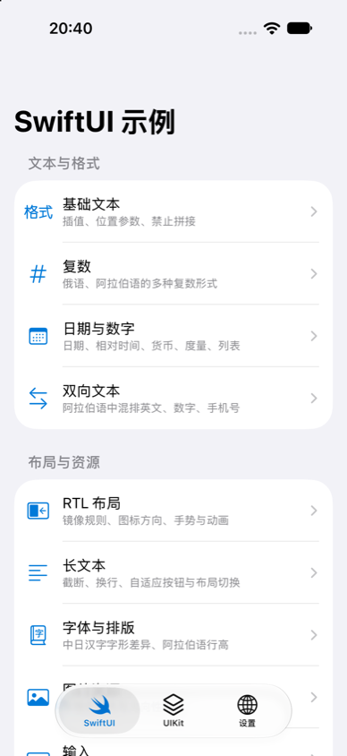
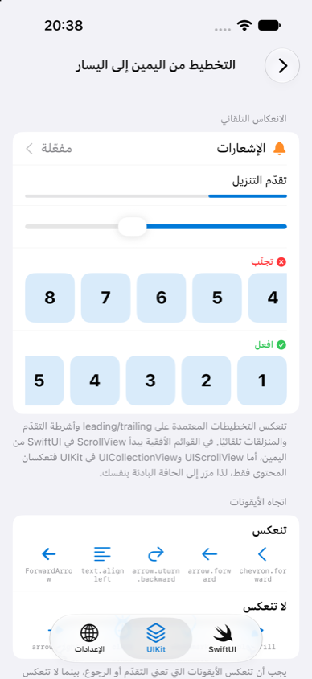
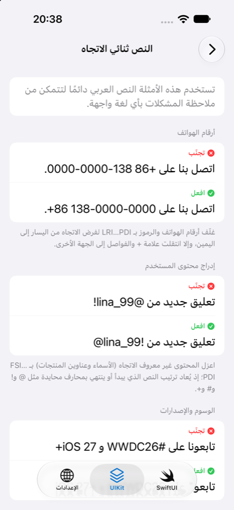
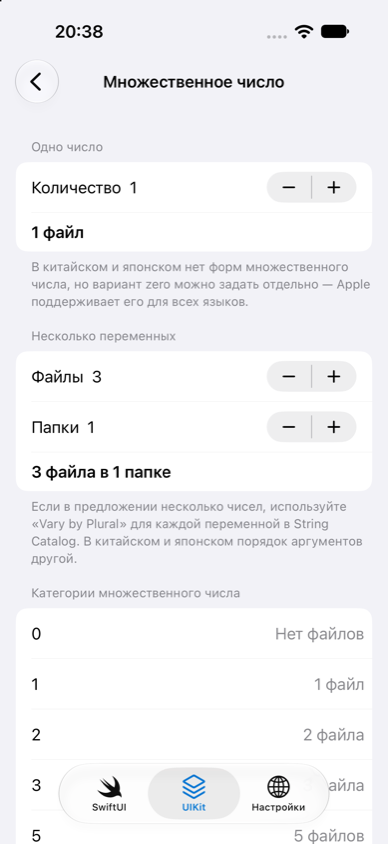
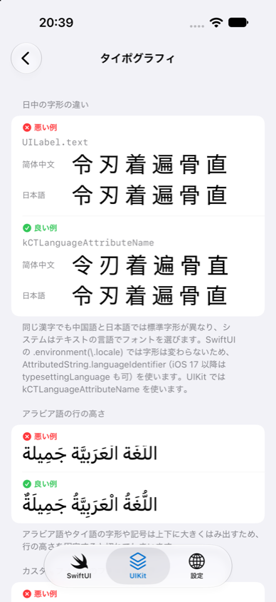
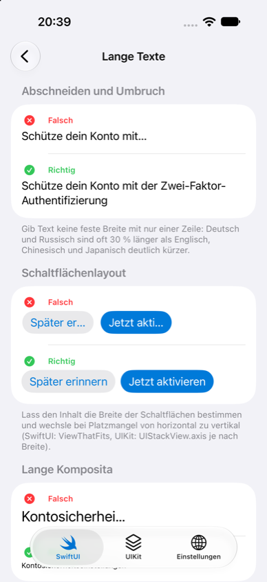

# WBLocalization

iOS 国际化适配实践项目：包含一套可直接用于生产的本地化框架、一个 SwiftUI 与 UIKit 对照的示例 App，以及一份可以直接落地的适配指南。

- **6 种语言**：简体中文（开发语言）、英语、阿拉伯语（RTL）、德语（长文本）、日语（字形与语序）、俄语（复杂复数）
- **App 内即时切换语言**，也支持系统的 per-app 语言设置
- **11 个适配主题**，每个都有 SwiftUI 和 UIKit 两套实现，并给出「错误示例 / 推荐做法」对照
- **翻译质量测试**：缺失翻译、占位符不一致、复数类别不全、废弃 key 都会让测试失败

| 中文 | 阿拉伯语 RTL | 双向文本 | 俄语复数 | 中日字形 | 德语长文本 |
| --- | --- | --- | --- | --- | --- |
|  |  |  |  |  |  |

## 文档

| 文档 | 内容 |
| --- | --- |
| [iOS 国际化适配指南](Docs/iOS国际化适配指南.md) | 真实项目怎么适配、会踩哪些坑、怎么解决，附坑速查表 |
| [开发设计文档](Docs/开发设计文档.md) | 架构、框架 API 设计、里程碑与实测结论 |

## 环境要求

| 项 | 版本 |
| --- | --- |
| Xcode | 27（Swift 6） |
| 最低系统 | iOS 15.0（测试 target 为 iOS 17.0） |
| 第三方依赖 | 无 |

## 快速开始

```bash
open WBLocalization.xcodeproj
```

选择 `WBLocalization` Scheme，运行到任意 iOS 模拟器。在「设置」Tab 中切换语言，或在 Scheme 的启动参数中勾选预置的 `-AppleLanguages (ar)` 等选项。

## 目录结构

```text
WBLocalization/
├── Packages/WBLocalizationKit/   # 本地化框架（Swift Package，可单独复用）
├── WBLocalization/               # 示例 App
│   ├── App/                      # 入口、根 Tab、调试启动参数
│   ├── Localization/L10n.swift   # 类型安全的文案入口
│   ├── Features/                 # 11 个适配主题，每个包含 XxxView（SwiftUI）+ XxxViewController（UIKit）
│   ├── Settings/                 # 语言设置页
│   └── Resources/                # String Catalog、Assets、启动屏
├── WBLocalizationTests/          # 翻译质量测试
├── Scripts/screenshots.sh        # 多语言截图
└── Docs/                         # 适配指南、设计文档、配图
```

## 示例内容

| 分组 | 主题 | 演示内容 |
| --- | --- | --- |
| 文本与格式 | 基础文本 | 位置参数、禁止拼接、各种取值 API 是否跟随 App 内切换 |
| | 复数 | 俄语 / 阿语的复数类别、多变量复数、zero |
| | 日期与数字 | 日期模板、相对时间、货币、单位、列表；地区决定数字字形和历法 |
| | 双向文本 | 手机号、昵称、话题标签在阿语中的乱序与隔离 |
| 布局与资源 | RTL 布局 | 自动镜像、图标方向、动画方向、横向列表起点、强制 LTR |
| | 长文本 | 截断、自适应按钮、横竖排切换、德语复合词断字 |
| | 字体与排版 | 中日汉字字形、阿语行高、自定义字体回退 |
| | 图片 | 本地化图片、方向性图片 |
| | 输入 | 输入框对齐、手机号与验证码强制 LTR、阿语数字解析 |
| 系统与服务端 | 系统文案 | App 名称、权限弹窗、系统控件文案、启动屏 |
| | 服务端内容 | Accept-Language、服务端时间、按语言区分缓存 |

## 接入 WBLocalizationKit

**1. 添加依赖**：在 Xcode 中通过 *Add Package Dependencies → Add Local…* 选择 `Packages/WBLocalizationKit`，或复制该目录到你的项目中。

**2. 启动时初始化**（在创建任何界面之前）：

```swift
import WBLocalizationKit

func application(_ application: UIApplication, didFinishLaunchingWithOptions ...) -> Bool {
    LocalizationManager.shared.bootstrap(fallbackLanguage: "en")
    return true
}
```

**3. 切换语言后重建界面**：

```swift
// UIKit
NotificationCenter.default.addObserver(forName: .wbLanguageDidChange, object: nil, queue: .main) { _ in
    MainActor.assumeIsolated {
        UIApplication.shared.relocalize { _ in RootViewController() }
    }
}

// SwiftUI：在根视图使用
ContentView().localizedRoot()
```

**4. 取文案**：

```swift
String(localized: "home.title", bundle: .localized)   // iOS 上必须传 bundle: .localized
"plurals.files".localized(count)                      // 按当前语言的复数规则格式化
```

### API 速查

| API | 说明 |
| --- | --- |
| `LocalizationManager.shared` | `bootstrap(fallbackLanguage:)`、`setLanguage(_:)`、`language`、`resolvedCode`、`locale`、`isRightToLeft`、`availableLanguages`、`openSystemLanguageSettings()` |
| `AppLanguage` | `.system` / `.specific(code)`；`nativeName`、`displayName(in:)`、`isRightToLeft`、`available(in:)` |
| `LanguageResolver` | 按偏好语言匹配，支持地区回退、文字变体回退（`zh-Hant` → `zh-Hans`）和兜底语言 |
| `Bundle.localized` | 当前语言的 `.lproj`，用于 `String(localized:bundle:)` |
| `LocalizationContext` | 任意线程可读的当前 `code` / `locale` |
| `LocalizedFormatters` | 日期、相对时间、数字、百分比、货币、单位、列表、文件大小；`posixDateFormatter()` |
| `String` 扩展 | `localized(_:)`、`bidiIsolated`、`forcedLeftToRight`、`forcedRightToLeft`、`removingBidiControls` |
| UIKit 扩展 | `UIApplication.relocalize(animated:rootBuilder:)`、`UIView.isRightToLeft`、`UIImage.directional`、`UIScrollView.scrollToLeadingEdge()` |
| SwiftUI 扩展 | `View.localizedRoot(_:rebuildsOnChange:)` |
| `AcceptLanguage` | `headerValue()`、`URLRequest.setAcceptLanguage()` |
| `Notification.Name.wbLanguageDidChange` | 语言切换完成后在主线程发送 |

## 测试

```bash
# 框架：macOS 与 iOS 模拟器都要跑（两个平台的本地化查找路径不同）
swift test --package-path Packages/WBLocalizationKit
xcodebuild test -scheme WBLocalizationKit -destination 'platform=iOS Simulator,name=iPhone 17 Pro'

# App 翻译质量测试
xcodebuild test -project WBLocalization.xcodeproj -scheme WBLocalization -destination 'platform=iOS Simulator,name=iPhone 17 Pro'

# 多语言截图，输出到 build/screenshots
Scripts/screenshots.sh "iPhone 17 Pro" build/screenshots ar de ja ru
```

## 维护文案

1. 在 Xcode 中打开 `WBLocalization/Resources/Localizable.xcstrings` 添加 key，并为每种语言填写译文、写清 Comment；
2. 在 `L10n.swift` 中添加对应的计算属性（不要用 `static let`）；
3. 运行 App 测试，确认没有缺失翻译、占位符不一致或复数类别不全。

## License

[MIT](LICENSE)
